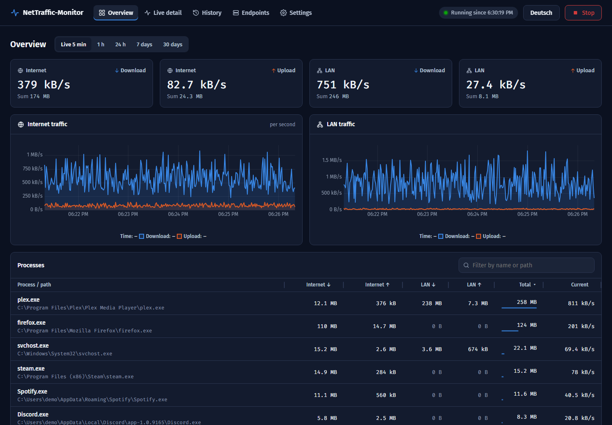
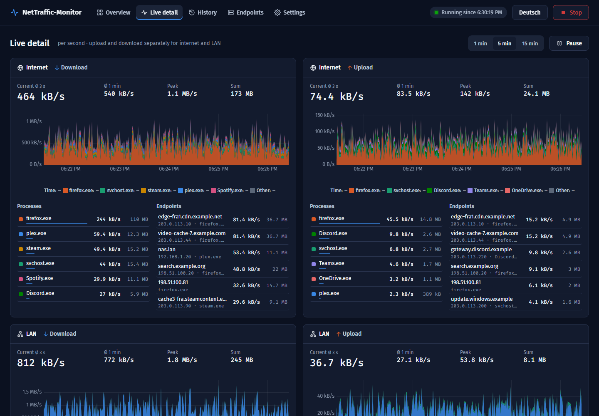
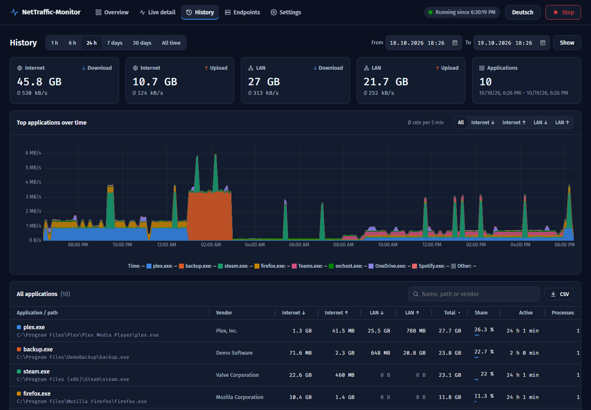
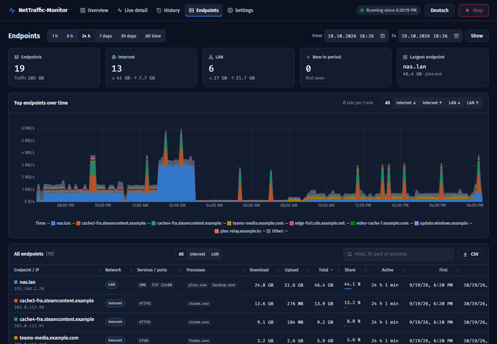
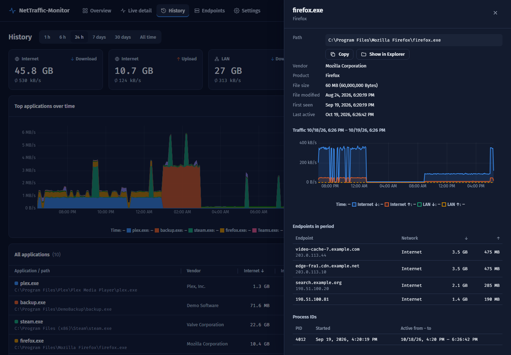

# NetTraffic-Monitor

Per-process network monitor for Windows. It records upload and download for every process once per second, splits traffic into **internal (LAN)** and **external (internet)**, stores it in a compact SQLite database and shows it on a local live dashboard.

Python 3.10+ required. If you want to use the System Service, a machine-wide python install is mandatory.



Initially created to investigate suspicious sporadic traffic, worked like a charm.

## Install and run

```
git clone https://github.com/webmj99/NetTraffic-Monitor.git && cd NetTraffic-Monitor
start.bat
```

Or `python -m nettraffic_monitor`. Administrator rights are required (UAC prompt), because per-process byte counters are only available through the ETW kernel network trace. The dashboard opens at http://127.0.0.1:8765/.

Options: `--port`, `--db data\nettraffic-monitor.db`, `--no-browser`, `--no-autostart`. Quit with Ctrl+C.

## Windows service

```
powershell -ExecutionPolicy Bypass -File install-service.ps1 [-Python C:\path\python.exe]
powershell -ExecutionPolicy Bypass -File install-service.ps1 -Uninstall
```

Installs NetTraffic-Monitor as an automatic-start LocalSystem service. The code is copied to `C:\Program Files\NetTraffic-Monitor` (re-run the installer to deploy changes), and a Python writable by normal users is refused, so install Python for all users: `winget install Python.Python.3.12 --scope machine`. Don't run `start.bat` while the service runs; both use the same port and ETW session.

## Configuration

`config.json` (for the service: `C:\Program Files\NetTraffic-Monitor\config.json`, then `Restart-Service NetTraffic-Monitor`):

```json
{ "port": 8765, "internal_networks": ["203.0.113.0/24", "2001:db8:1::/48"] }
```

`internal_networks` adds CIDRs that count as LAN (private, link-local, CGNAT, ULA and the local /64 already do).

## Views

- **Overview**: internet and LAN charts, current rates, process table (5 min … 30 days).
- **Live detail**: per-channel charts stacked by process, live rankings of processes and remote endpoints.
- **History**: all applications in a period with totals, shares and CSV export.
- **Endpoints**: all remote endpoints with reverse DNS, ports, processes and CSV export.
- **Settings**: data retention and database maintenance (cleanup, compact/VACUUM, WAL checkpoint, integrity check).

| Live detail | History |
|---|---|
|  |  |
| **Endpoints** | **Process details** |
|  |  |

Screenshots show mock data.

The UI is in English by default; the button in the top bar switches to German (remembered per browser).

Data is stored per second (only seconds with traffic) plus a per-minute rollup; endpoints are stored per minute. By default everything is kept forever. Under **Settings** you can set separate retention periods (in days) for per-second detail, per-minute history and endpoints. Periods older than the per-second retention are then shown from per-minute data. Cleanup runs after saving and every 6 hours (can be turned off), deletes in small batches while monitoring continues, and asks for confirmation with the number of rows first. Deleting doesn't shrink the file: use **Compact database**, or let NetTraffic-Monitor compact automatically once 25 % of the file is free. Settings are stored in the database, not in `config.json`.

## Security

The dashboard binds to `127.0.0.1` only and has no login: any local user or process can view it and start/stop monitoring.

## Caveats

- **VPN:** traffic is counted once for the app and again for the VPN client, so per-process totals double-count it. Addresses inside a VPN are private and count as LAN.
- Processes are grouped by executable path, so all `svchost.exe` services share one row.
- Traffic to the host's own addresses counts as loopback and is ignored.

## License

Project is released under GPL-3.0, see [LICENSE](LICENSE).
The vendored uPlot (`nettraffic_monitor/static/vendor/`, `(c) 2022 Leon Sorokin`) is MIT licensed. 
The fonts Fira Sans and Fira Code (`nettraffic_monitor/static/fonts/`) are licensed under the SIL Open Font License 1.1.

##
Co-developed by Claude Code.
